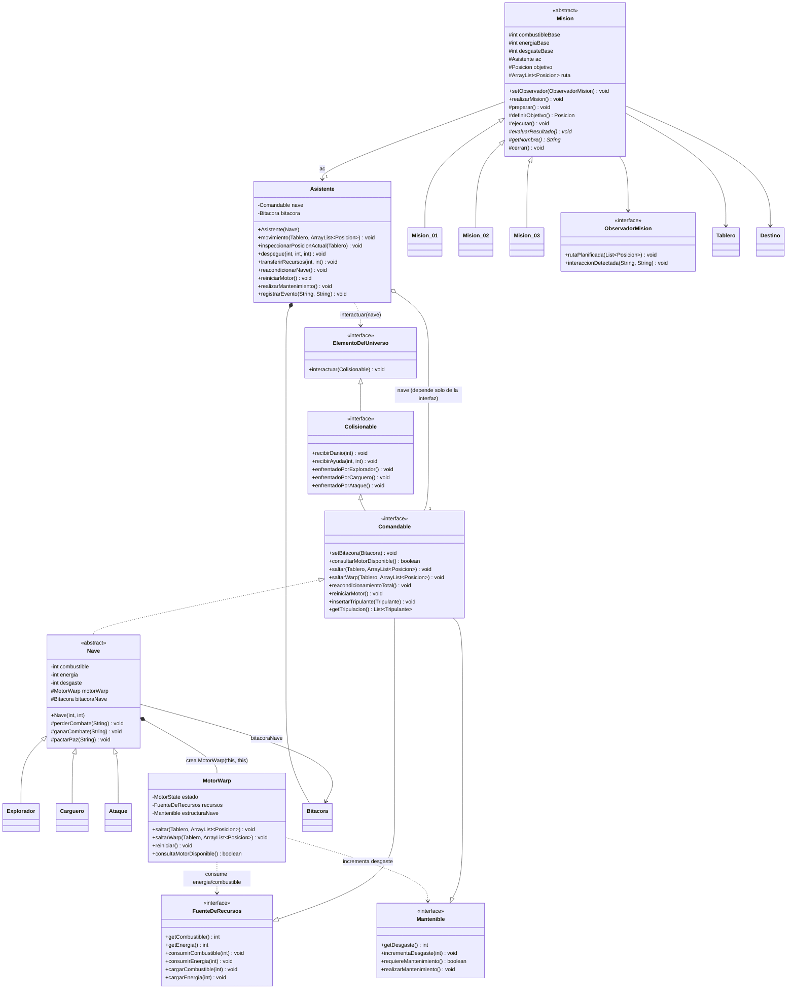
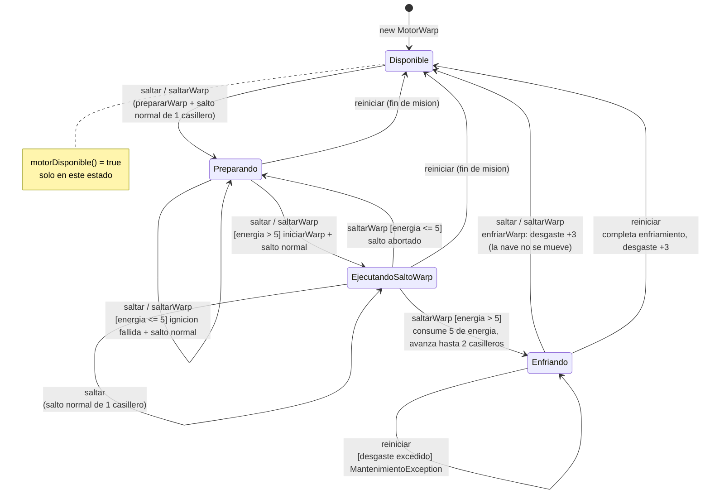
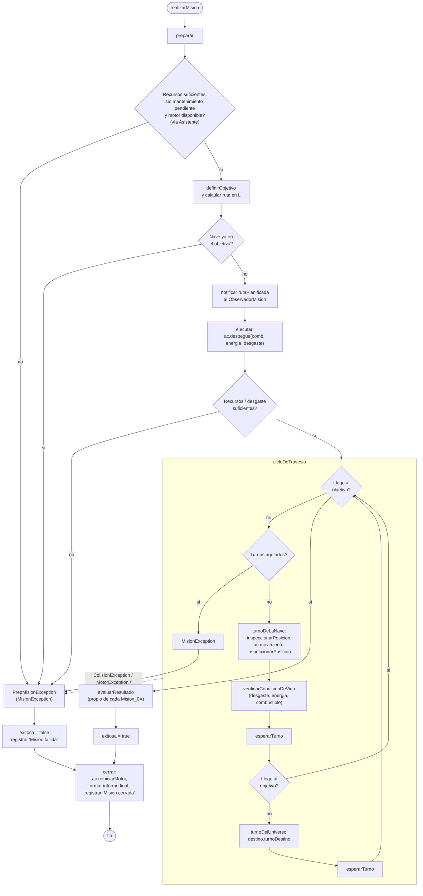
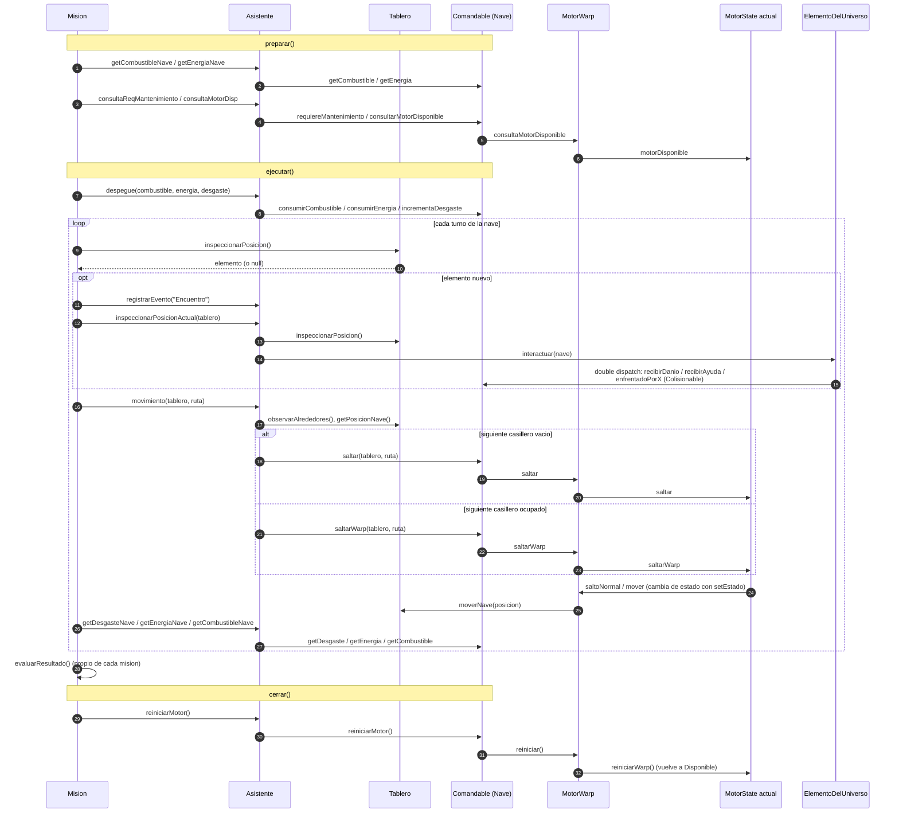

# Diagramas del modelo de dominio

Diagramas en Mermaid generados a partir del código (sin modificarlo). Se excluyen vistas, controladores, `Tripulante` y sus decoradores.

## 1. UML: Comandable, Nave, Asistente y Misión

Notas:
- `Colisionable` extiende `ElementoDelUniverso`, por eso una `Nave` (vía `Comandable`) también es un elemento con `interactuar(...)`. Eso habilita el *double dispatch* entre un elemento y la nave.
- `Asistente` recibe una `Nave` en el constructor, pero la guarda como `Comandable`.
- `Mision` nunca toca la nave: todo pasa por `Asistente`.

## 2. Diagrama de estados del MotorWarp

Patrón State: `MotorWarp` delega en un `MotorState` (`DisponibleState`, `PreparandoState`, `EjecutandoSaltoWarpState`, `EnfriandoState`). El evento `saltar` / `saltarWarp` es el que dispara la mayoría de las transiciones.

Operaciones directas inválidas (lanzan excepción, no cambian el estado):

| Estado | `prepararWarp` | `iniciarWarp` | `ejecutandoWarp` | `enfriarWarp` |
|---|---|---|---|---|
| Disponible | → Preparando | `TransicionInvalida` | `TransicionInvalida` | `TransicionRedundante` |
| Preparando | `TransicionRedundante` | → EjecutandoSaltoWarp (si hay energía) | `TransicionInvalida` | `TransicionInvalida` |
| EjecutandoSaltoWarp | `TransicionInvalida` | `TransicionRedundante` | → Enfriando / Preparando | `TransicionInvalida` |
| Enfriando | `TransicionInvalida` | `TransicionInvalida` | `TransicionRedundante` | → Disponible |

## 3. Flujo de la misión → Asistente → Nave (vía Comandable)

### 3.1 Flujo general (`Mision.realizarMision`, método template)

### 3.2 Comunicación Mision → Asistente → Comandable (turno de la nave)

Notas:
- Las excepciones (`ColisionException`, `MotorException`, `RecursosInsuficientesException`, `MantenimientoException`) se traducen a `MisionException` en `turnoDeLaNave` y `ejecutar`, y llevan al cierre con misión fallida.
- `Asistente` decide entre `saltar` y `saltarWarp` según el radar (`observarAlrededores`): casillero siguiente vacío → `saltar`; ocupado → `saltarWarp`. La política de transiciones queda en los estados del motor (ver diagrama 2).
